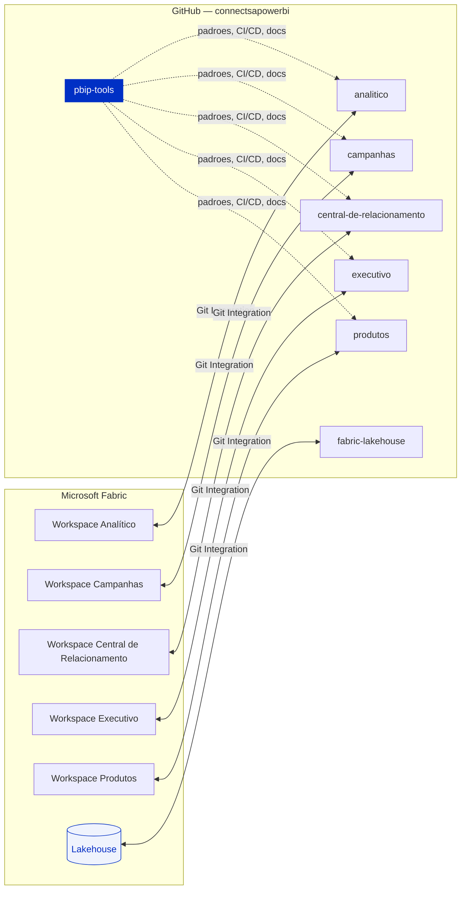

# Connect Informações e Tecnologia SA

**Business Intelligence & Analytics**

Desenvolvimento e governança de dashboards Power BI para apoio à decisão estratégica e operacional.

 

---

## Ecossistema

Cada área de negócio tem um workspace no Microsoft Fabric sincronizado por Git
Integration com o repositório correspondente. O `pbip-tools` centraliza
scripts, padrões técnicos, agentes de IA e os workflows de CI/CD reutilizados
por todos os repositórios de dashboard.

`main` é o estado publicado de cada repo — todo push nessa branch dispara o
deploy via GitHub Actions para o workspace Fabric da área (`dev` → `hml` →
`main`).

---

## Repositórios

| Repositório | Área | Camada | Dashboards |
|-------------|------|--------|:----------:|
| [**analitico**](https://github.com/connectsapowerbi/analitico) | Comercial | Report + Semantic Model | 11 |
| [**campanhas**](https://github.com/connectsapowerbi/campanhas) | Gestão de Produtos Serasa | Report + Semantic Model | 20 |
| [**central-de-relacionamento**](https://github.com/connectsapowerbi/central-de-relacionamento) | Central de Relacionamento | Report + Semantic Model | 2 |
| [**executivo**](https://github.com/connectsapowerbi/executivo) | Diretoria | Report + Semantic Model | 6 |
| [**produtos**](https://github.com/connectsapowerbi/produtos) | Comercial | Report + Semantic Model | 6 |
| [**fabric-lakehouse**](https://github.com/connectsapowerbi/fabric-lakehouse) | Data Engineering | Lakehouse / Warehouse | — |
| [**pbip-tools**](https://github.com/connectsapowerbi/pbip-tools) | Ferramentas | Scripts, CI/CD e docs compartilhados | — |

---

